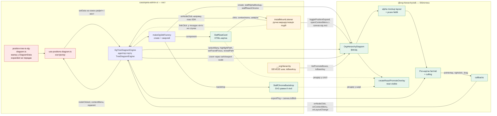
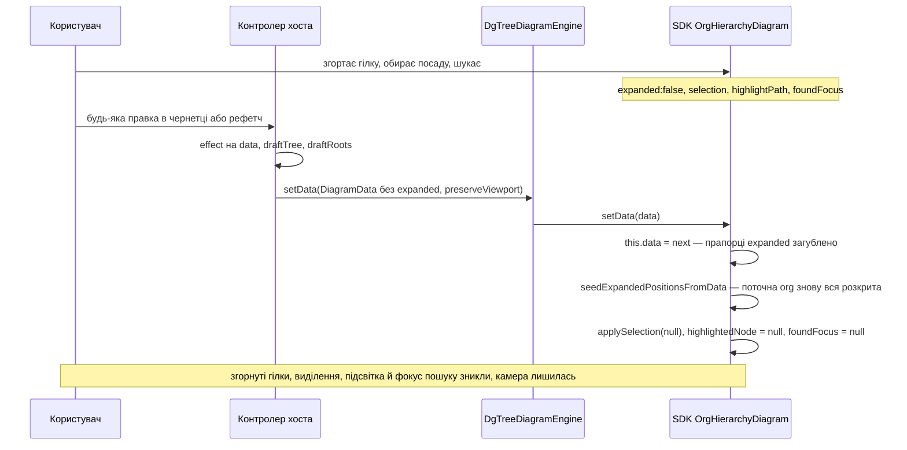
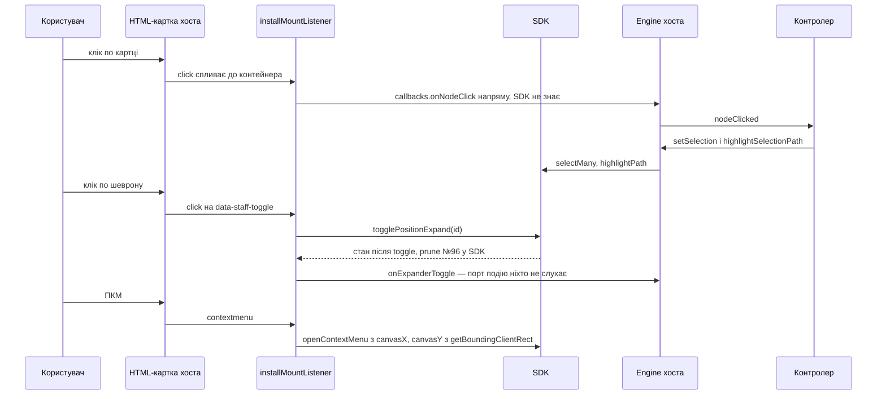

# Взаємодія dg ↔ cassiopeia-admin-ui (ШПС) — діаграма й знахідки

**Дата:** 2026-11-05 · **dg:** гілка `feat/t132-devtools-panel` @ `646e58c` · **хост:** `cassiopeia-admin-ui`,
гілка `b2w/queue/springs/spring-13/4311-shps-diagram-palette` @ `61459a01c`
**Як знято:** читанням коду обох репо (не переказом). На стенді **не перевірено** — кожну знахідку з
позначкою ❌ варто підтвердити кліком на стенді хоста перед тим, як лагодити.

**Легенда:** ✅ працює · ⚠️ працює на милиці хоста · ❌ дефект (з коду) · 🔜 заплановано / вже в SDK, але хост
ще не перейшов · 💤 мертвий шлях

---

## 1. Хто що робить

Межа одна й проста: **зблизька** картку малює хост (HTML у слоті оверлея SDK), **здалеку** — Pixi
бібліотеки. Усе, що SDK робить для Pixi-картки (клік, ПКМ, drag, hover), для HTML-картки або повторює
хост руками, або не робить ніхто.

---

## 2. Найважливіший ланцюг — кожен `setData` скидає стан перегляду ❌

Докази:
- SDK `setData` → `seedExpandedPositionsFromData()` + `applySelection(null)` + `highlightedNode = null` +
  `foundFocus = null` — `packages/sdk/src/OrgHierarchyDiagram.ts:1364-1390`.
- Рольовий дефолт: у поточній org `expanded !== false` → розкрито (`seedExpandedPositionsFromData`).
  Ручне згортання живе лише як `expanded:false` у `this.data` і переживає `setData`, **тільки якщо хост
  передасть його назад** (#96 plan §2.1).
- Мапер хоста `expanded`/`collapsed` не пише взагалі — `position-tree-to-dg-diagram.ts` (grep порожній).
- Контролер шле `setData` на зміну `data`, `draftTree`, `draftRoots` —
  `use-positions-diagram.ts:405-422`; виділення після цього не відновлює (лише в обробниках кліку, `:250-258`).

**Чия відповідальність:** бібліотеки. Хост — знімкова модель (ADR-0067 у хості), тож SDK має
**зберігати стан перегляду через `setData`** для id, що лишились.
**Не регресія:** попередній GoJS-рушій хоста теж скидав розгорнутість на кожному `setData`
(`gojs-tree-diagram.engine.ts` → `this.expandedKeys.clear()` + нова модель). Таска —
[T133](../../tasks/T133-setdata-preserves-view-state.md).

---

## 3. Клік і шеврон на near-картці ⚠️

Докази: `make-dg-sdk-factory.ts:387-466`; SDK емітить події лише для Pixi —
`render/personInteractions.ts:150`, `render/personCardContent.ts:222`, `render/cardContextMenu.ts:13`.
**Заплановано:** [T130](../../tasks/T130-near-card-event-seam.md) — хост віддає лише шаблон, події й координати дає SDK.

---

## 4. Повний перелік

| # | Що | Статус | Доказ | Чиє |
|---|---|---|---|---|
| D1 | Кожен `setData` скидає згортання, виділення, підсвітку шляху й фокус пошуку | ❌ | §2 | бібліотека |
| D2 | Кнопки зуму +/− масштабують навколо кута полотна, а не центру | ❌ | `dg-tree-diagram.engine.ts` `increaseZoom`/`decreaseZoom` → `setViewport({scale})`; SDK має `zoomBy` «around viewport center (toolbar +/-)» — `OrgHierarchyDiagram.ts:2129-2132` | **бібліотека** — [T134](../../tasks/T134-zoom-controls-in-library.md) (рішення власника) |
| D3 | PNG-експорт = сирий `canvas.toBlob`: лише видимий кадр, без HTML-карток і SVG-хрому | ❌ | `dg-tree-diagram.engine.ts` `exportPng`; SDK має `export({format:'png', scope:'full'})` — `OrgHierarchyDiagram.ts:2449`, `docs/USAGE.md:727-729`. Чи вміє SDK-експорт alpha/React-хром — **не перевірено** | **бібліотека** — [T135](../../tasks/T135-export-matches-screen.md): `export()` теж не знімає React-хром на near/mid (`DiagramRenderer.ts:760-767`) |
| D4 | Reparent перетягуванням на near-зумі неможливий: HTML-картка перехоплює вказівник, а Pixi-картка прихована, поки картку підняли | ❌ не виміряно наживо | слот оверлея `pointerEvents:'auto'` — `react/createReactPromoteOverlay.ts:583`; drag живе лише в Pixi — `render/personInteractions.ts:194-287` | бібліотека (T130) |
| D5 | Hover-підсвітка пов'язаних (`installStaffHoverHighlight`) є лише в демо; у SDK і хості її немає | ❌ | `packages/demo/src/app/StaffChromeBackdrop.ts`; grep у SDK і хості порожній | бібліотека |
| D6 | `reveal()` хоста виділяє вузол, хоча порт обіцяє «без виділення» | 🔜 | SDK `revealPath(id, {select:false})` — `945069b`; хост ще кличе без опції | хост перейти |
| D7 | Клік, ПКМ і шеврон near-картки маршрутизує хост | ⚠️ | §3 | бібліотека (T130) |
| D8 | Ключі: бокси `position:<guid>`, тест-шов транслює `toBareKey`/`toSdkKey` | ⚠️ лише DEV/E2E | `use-positions-diagram.ts:163-170`; вхід SDK поблажливий — `SceneRegistry.ts:59-71` | хост прибрати; бібліотека задокументувати |
| D9 | `linkClick` з лінії хрому: фабрика шле, у посадах ніхто не слухає | 💤 (так було й з GoJS) | слухає лише `org-hierarchy/controllers/use-org-hierarchy-diagram.ts:156` | — |
| D10 | `invalidateIcon` — порожній; оновлене лого/фото не скидається з кешу | ⚠️ вплив не виміряно | `dg-tree-diagram.engine.ts` `invalidateIcon`; у SDK є `media` — `docs/USAGE.md` §8 | хост підключити |
| D11 | `highlightSelectionPath` бере лише перший ключ; `badgeText` у `setFoundFocus` ігнорується | ⚠️ дрібне | `dg-tree-diagram.engine.ts` | — |
| D12 | Refit після згортання вимкнено за замовчуванням | 🔜 за задумом | `staffRefitOnToggle` — `646e58c` (T131); вмикатиметься з dev-tools — T132 | — |

**Працює, як задумано:** лічильники підлеглих (`getNode().getData()`, SDK ≥1.1.1) ✅ · прунінг #96 ✅ ·
culling ✅ (внутрішній, хост нічого не робить) · контекстне меню ✅ (з милицею D7) · тема ✅ ·
збереження камери на рефетчі (`preserveViewport`) ✅ · тест-якорі DEV ✅.
**Не перевірено:** чи alpha-шлях узагалі підключає Pixi-drag на mid/far (тобто чи `reparent` з діаграми
досяжний хоч на якому зумі) — механізм є (`personInteractions.ts`, `dragMode` деф. `'move'`), wiring на alpha не звірено.

## 5. Що з цього випливає

1. **D1 — головний кандидат на «працює не до кінця».** Воно б'є на кожній правці. Лагодити — у бібліотеці:
   `setData` має переносити стан перегляду на ті самі id. Потрібна окрема таска й рішення власника.
2. **D2 і D3 — бібліотека** (рішення власника): T134 (зум), T135 (експорт як на екрані).
   **D6, D8, D10** — хост переходить на вже готовий API бібліотеки.
3. **D4, D5, D7 — не «зламано», а ще не дійшли:** це рівно шов T130 (шаблон + події від SDK) і R1 роадмапу
   (hover у бібліотеці).
